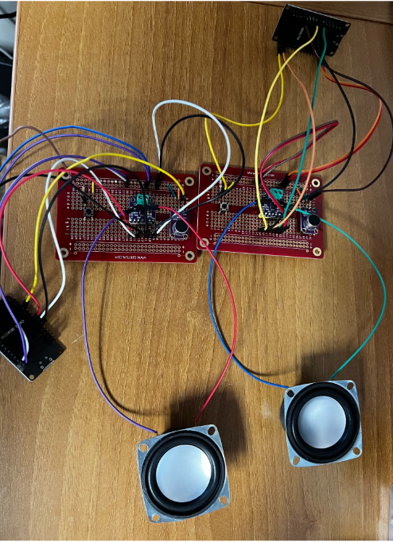

# ESP32 Walkie-Talkie

[](https://github.com/evannroche/ESP32-Walkie-Talkie/actions/workflows/ci.yml)

A push-to-talk voice radio built from two ESP32 boards that talk directly over ESP-NOW, with no Wi-Fi router in between. Hold the button to record up to 3 seconds of audio, release it to send, and the other board reassembles the message and plays it through a MAX98357A I2S amplifier.



```
Mic -> ADC1 -> 8 kHz / 8-bit buffer -> packet framing -> ESP-NOW ))) 
                                                                    |
Speaker <- MAX98357A <- I2S <- playback buffer <- reassembly <------+
```

## Highlights

- Custom packet protocol with sequence numbers, duplicate suppression and loss handling, so a dropped packet becomes a short gap of silence instead of corrupting the rest of the message
- ESP-NOW callbacks kept minimal: packets go through a FreeRTOS queue to a receiver task that double-buffers reassembly
- DMA-paced I2S playback and ADC capture with gain and running DC-offset removal
- Hardware-independent protocol and audio code covered by native unit tests, built and tested in CI

## Hardware

- 2x ESP32-WROOM-32 dev boards (`esp32dev`)
- Microphone with a biased analog output (for example an electret capsule with a preamp module)
- MAX98357A I2S amplifier and a small speaker
- Momentary push button

| ESP32 pin | Function | Connects to |
| --- | --- | --- |
| GPIO34 | ADC1_CH6 audio input | Microphone module output |
| GPIO23 | Push-to-talk (active high) | Button to 3.3 V, internal pulldown |
| GPIO2 | Status LED | Onboard LED |
| GPIO26 | I2S BCLK | MAX98357A BCLK |
| GPIO25 | I2S LRCLK | MAX98357A LRC |
| GPIO22 | I2S data out | MAX98357A DIN |
| GPIO27 | Amplifier enable | MAX98357A SD |

Pins are defined in [`src/config.h`](src/config.h). Don't wire a bare electret capsule straight to GPIO34; it needs a bias and gain stage first.

## Build and flash

Requires [PlatformIO Core](https://docs.platformio.org/en/latest/core/installation/index.html).

```sh
pio run                            # build both board variants
pio run -e esp32-left -t upload    # flash the left board
pio run -e esp32-right -t upload   # flash the right board
pio device monitor -b 115200       # serial log
pio test -e native                 # run unit tests on your laptop
```

Each board needs its partner's MAC address. They're set per environment in `config.h`; each board prints its own MAC on boot, so check the serial monitor and update the addresses if you're using different boards.

## How it works

**Audio format.** Speech is captured at 8 kHz, 8-bit mono, which is 8 KB per second and enough for clear voice. Samples are expanded to 16-bit stereo only at playback time for the I2S amplifier.

**Packet format.** Every packet starts with a 12-byte little-endian header:

| Field | Bytes |
| --- | --- |
| Magic | 1 |
| Version | 1 |
| Type (start / audio) | 1 |
| Reserved | 1 |
| Message ID | 2 |
| Sequence number | 2 |
| Packet count | 2 |
| Sample count | 2 |

Audio packets carry up to 238 bytes of samples, staying under ESP-NOW's 250-byte limit. A full 3-second message is one start packet plus 101 audio packets.

**Loss and reordering.** The receiver tracks packets with a bitmap, drops duplicates, and can begin a message from any audio packet if the start packet was lost. After the last packet arrives it waits up to 150 ms for stragglers, and a 350 ms idle timeout flushes incomplete messages. Missing chunks are filled with silence so the rest of the audio stays aligned.

**Concurrency.** The ESP-NOW receive callback runs in the Wi-Fi task, so it only copies the packet into a FreeRTOS queue. A dedicated receiver task does reassembly into one of two buffers and hands finished messages to the main loop. A buffer isn't reused until playback releases it, and the radio ignores new messages while recording, sending or playing.

**Drivers.** Capture uses `adc_oneshot` with adjustable gain and DC-offset tracking. Playback uses `i2s_std`, writing samples in blocks and letting DMA set the timing.

## Limitations and next steps

- Half-duplex with a 3-second cap per message
- No encryption, secure pairing, acknowledgements or retransmission; peer MAC filtering is not authentication
- Capture is polled with `micros()` and can jitter under load; moving to a hardware timer or continuous ADC DMA is next
- Lost audio is replaced with silence, with no jitter buffer or error correction
- Range, latency and packet loss haven't been benchmarked yet

## Project layout

```text
src/main.cpp           Button debounce and state machine
src/config.h           Pins, sample rate, peer MAC addresses
src/audio_capture.*    ADC capture and DC-offset removal
src/audio_playback.*   Block-based I2S output
src/transport.*        ESP-NOW callbacks, FreeRTOS queues, TX/RX tasks
lib/walkie_core/       Hardware-independent packet codec and reassembler
test/test_protocol/    Native Unity tests
.github/workflows/     CI: firmware build and unit tests
```
